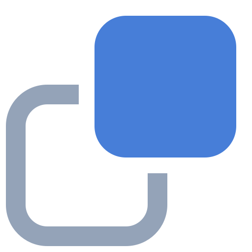

# deBackground 🚀

**deBackground** is a professional-grade, 100% private, and free AI background remover that runs entirely in your browser. No signups, no fees, and no data ever leaves your device.



## ✨ Features

- **🛡️ 100% Private**: All AI processing happens locally in your browser using Transformers.js. Your photos are never uploaded to any server.
- **⚡ Browser-Native Performance**: Built with Astro, using WebGPU where available and falling back to WASM.
- **💎 Studio-Quality**: Advanced AI models handle complex edges like hair and transparent objects with precision.
- **🖼️ Anything, Not Just People**: General-purpose segmentation covers products, objects, animals and plants.
- **🔓 Unlimited & Free**: No daily quotas, no watermarks, and no hidden fees.
- **🎨 Custom Backgrounds**: Replace removed backgrounds with solid colors or your own images.

## 🛠️ Tech Stack

- **Runtime**: [Bun](https://bun.sh/)
- **Framework**: [Astro](https://astro.build/) + [React](https://reactjs.org/)
- **AI Engine**: [Transformers.js](https://huggingface.co/docs/transformers.js/) (MIT)
- **Model**: `studioludens/birefnet-lite-512`
- **Styling**: [Tailwind CSS v4](https://tailwindcss.com/)
- **State Management**: [Zustand](https://github.com/pmndrs/zustand)

## 🧠 The Model

deBackground runs [BiRefNet_lite](https://github.com/ZhengPeng7/BiRefNet) (MIT) at 512×512,
then scales the predicted mask back up to your image's full resolution.

The weights download once and are cached by the browser. Which build you get depends on
your device:

| Backend | Weights | Notes |
| :--- | :--- | :--- |
| WebGPU + fp16 | 98 MB | Requires a GPU adapter reporting `shader-f16` |
| WebGPU + fp32 | 192 MB | WebGPU adapters without fp16 support |
| WASM + fp32 | 192 MB | CPU fallback — noticeably slower |

Firefox ships WebGPU disabled by default; enable `dom.webgpu.enabled` in `about:config`
for the fast path. Desktop Safari support is partial. If a backend fails to load or run,
the worker retries on WASM before reporting an error.

### Working resolution

Images are downscaled to at most **2048px on the longest edge** before processing, and
the result is produced at that size. Since the mask is predicted at 512×512 and scaled
up regardless, larger inputs sharpen only the colour channels while multiplying memory:
every pipeline stage holds another full-size buffer, and a 12 MP phone photo is enough
to exhaust a mobile browser's renderer and crash the tab.

### Why 512 and not 1024

The 1024×1024 export is more accurate on fine edges but does not run in a browser.
Its heaviest shader binds 11 storage buffers per stage while many GPU adapters cap at
10, and the CPU backend runs out of memory at that resolution. No quantized BiRefNet
build is published, so shrinking it that way isn't an option either. The worker logs
the adapter's reported limit and its chosen backend under `[background-removal]`.

## 🚀 Getting Started

### Prerequisites

Ensure you have [Bun](https://bun.sh/) installed.

### Installation

1. Clone the repository:
   ```bash
   git clone https://github.com/kcsujeet/debackground.git
   cd debackground
   ```

2. Install dependencies:
   ```bash
   bun install
   ```

3. Start the development server:
   ```bash
   bun dev
   ```

4. Open [http://localhost:4321](http://localhost:4321) in your browser.

## 📖 Commands

| Command | Action |
| :--- | :--- |
| `bun dev` | Starts local dev server at `localhost:4321` |
| `bun run build` | Build your production site to `./dist/` |
| `bun run preview` | Preview your build locally |
| `bun run check` | Run Biome checks and formatting |


